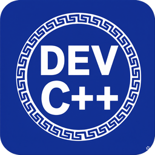

<p align="center">
  
</p>

<h1 align="center">Diadochi Dev C++</h1>

<p align="center">
  A modern editor shell over the Dev-C++ compiler, with Rust-style safety rules for C and C++.<br>
  Written in Rust. Windows. Dev-C++ itself is never modified.
</p>

---

## Why

Dev-C++ is a fast, friendly way to start with C and C++, but its editor looks dated and it lets you build code that
will crash, leak, or corrupt memory without a word. Rust refuses to compile that kind of code.

Diadochi sits on top of the compiler that ships with Dev-C++ (MinGW / TDM-GCC) and adds a modern UI plus a
checker that stops the classic memory mistakes *before* you build.

## Features

- **Uses your existing Dev-C++ compiler.** Auto-detects the install, or you point it at the folder.
- **Three themes:** Bloomberg terminal (dark, amber on black), Catppuccin Mocha (dark), Windows 11 (light).
- **Rust-style safety rules** for C and C++, shown rustc-style with a code frame, a caret, and a `help:` fix.
- **Strict mode:** safety errors block Build and Run, like rustc refusing to compile.
- **Waivers:** silence a finding on purpose, but you must give a reason (the equivalent of `unsafe`).
- **Typing assistance:** auto-close `()` `[]` `{}` `""` `''`, smart Enter, Backspace and Tab.
- **Format document** (Ctrl+Shift+F): operator and comma spacing, `if (` / `for (`, brace-based re-indent.
- **Editor zoom:** Ctrl + mouse wheel, Ctrl +/-, Ctrl+0.
- Syntax highlighting, line numbers with error/warning marks, click-to-jump problems list.
- Dev-C++ shortcuts: **F9** build, **F11** build and run.
- Builds run on a background thread, so the UI never freezes.

## Safety rules

Strict mode blocks on **errors**. Warnings are shown but never block.

| Code | Level | What it catches |
|------|-------|-----------------|
| DR001 | error | `gets()` |
| DR002 | error | `strcpy` / `strcat`: destination size unknown |
| DR003 | error | `sprintf` / `vsprintf`: unbounded write |
| DR004 | error | `scanf("%s")` without a width |
| DR008 | error | `printf(variable)`: format-string vulnerability |
| DR101 | error | `malloc` / `calloc` / `fopen` result used without a NULL check |
| DR103 | error | allocation never released and never handed off (leak) |
| DR104 | error | wrong release API (`malloc`+`delete`, `new[]`+`delete`, ...) |
| DR105 | error | double free |
| DR106 | error | use after free |
| DR107 | error | returning a pointer to a local variable |
| DR108 | error | local variable read before it is assigned |
| DR109 | error | constant array index out of bounds |
| DR110 | error | off-by-one loop (`i <= SIZE` indexing an array of `SIZE`) |
| DR005-007, DR009-017, DR102 | warning | `atoi`, `system`, `goto`, `void main`, `fflush(stdin)`, string literal to `char*`, raw `new`/`delete`, C-style casts, mutable globals, `alloca`, `strncpy`, unsafe `realloc` |

The full list is in the app under **Rules**.

### Example

```
error[DR106]: 'data' is used after it was freed (line 21): the pointer dangles
 --> line 22:27
   22 |     printf("%d\n", data[0]);
      |                    ^^^^
      = help: don't touch data after the free, or re-assign it first
```

### Waivers

```c
// diadochi:allow(DR002) name is capped at 7 chars by the caller
strcpy(buf, name);
```

A waiver without a reason is ignored. Waived findings stay in the Problems list as an audit trail.

## Modes

| Mode | Behaviour |
|------|-----------|
| Strict (default) | Safety errors block the build. Also passes `-Werror=return-type` and `-Werror=format-security`. |
| Relaxed | Everything is shown, nothing blocks. |
| Off | No checks. |

## Install and build

Requirements: Windows, [Rust](https://rustup.rs) (stable), and [Dev-C++](https://github.com/Embarcadero/Dev-Cpp) (Orwell 5.11 or Embarcadero).

```
git clone <this repo>
cd diadochi-devcpp
build.bat
```

`build.bat` runs `cargo build --release` and copies the result to `Diadochi-DevCpp.exe`.
Or run it directly:

```
cargo run --release
```

The first release build takes a few minutes while egui compiles.

### Compiler detection

Looks for `g++.exe` in this order:

1. The folder set in **Settings**
2. The `DIADOCHI_DEVCPP` environment variable
3. `Program Files (x86)\Dev-Cpp`, `Program Files\Dev-Cpp`, `C:\Dev-Cpp`, `D:\Dev-Cpp`
4. `PATH`

Either the Dev-C++ install folder or its compiler `bin` folder works. Compiler flags are chosen by GCC version,
so older compilers (Dev-C++ 5.11 ships GCC 4.9.2) don't get flags they don't support.

### Fonts

Uses JetBrains Mono if found (an `assets` folder next to the .exe, or installed on the system), then Consolas,
then egui's built-in monospace.

### Exe icon

`build.rs` embeds `assets/icon.ico` into the .exe. This needs a Windows resource compiler (MSVC Build Tools or
MinGW `windres`). If none is found the build still succeeds and only the exe's file icon is the default; the
window icon is always embedded.

## Shortcuts

| Key | Action |
|-----|--------|
| F9 | Build |
| F11 | Build and run |
| Ctrl+S | Save |
| Ctrl+Shift+F | Format document |
| Ctrl + wheel, Ctrl +/- | Zoom editor |
| Ctrl+0 | Reset zoom |
| Tab / Shift+Tab | Indent / dedent (works on a selection) |

## Limitations

The safety checker is a heuristic text analyzer, **not a real borrow checker**.

- It has false positives. For example, passing a pointer to your own function counts as handing over ownership.
- It has false negatives: aliasing, pointers stored in structs, and anything that crosses functions.
- The formatter is conservative and skips `#` lines and lines containing `operator`.

Planned: a real syntax tree (tree-sitter or libclang) with per-function ownership dataflow, then cross-function checks.

## Project layout

```
src/main.rs        UI, build flow, settings
src/safety.rs      safety rule engine and waivers
src/compiler.rs    Dev-C++ compiler detection and invocation
src/autoedit.rs    auto-close brackets, smart Enter/Backspace/Tab
src/format.rs      document formatter
src/highlight.rs   C/C++ syntax highlighting
src/theme.rs       the three themes
build.rs           embeds the exe icon
```

Run the rule and formatter tests with `cargo test`.

